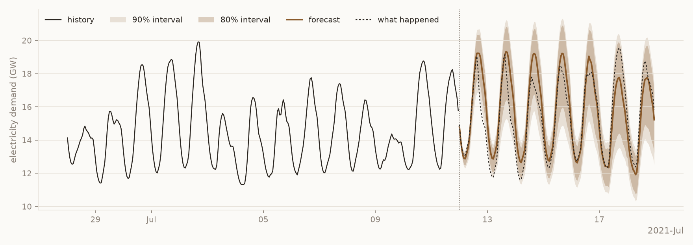
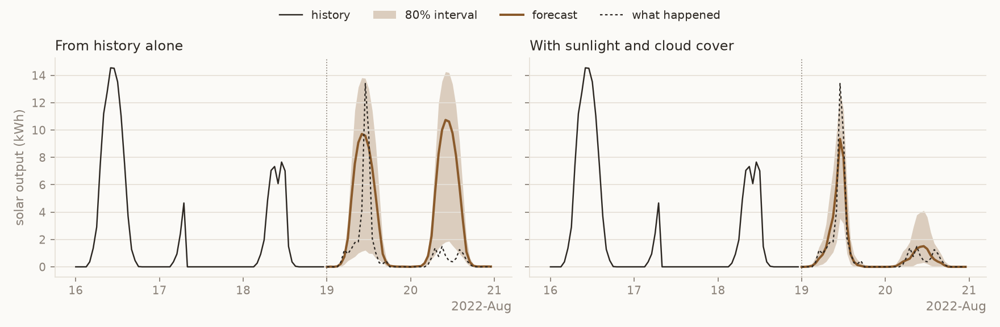

<h1 align="center">yhatmodels</h1>

<p align="center">Open foundation models from YHat Labs that run on your own computer.</p>

<p align="center">
  <a href="https://github.com/yhatlabs/yhatmodels#quick-start"><b>Install</b></a> ·
  <a href="https://github.com/yhatlabs/yhatmodels#what-you-can-do">What you can do</a> ·
  <a href="https://github.com/yhatlabs/yhatmodels#results">Results</a> ·
  <a href="https://github.com/yhatlabs/yhatmodels/blob/main/docs/usage.md">Usage guide</a> ·
  <a href="https://huggingface.co/yhatlabs/ChakraTS-OS-10M">Model card</a>
</p>

<p align="center">
  <picture>
    <source media="(prefers-color-scheme: dark)" srcset="https://raw.githubusercontent.com/yhatlabs/yhatmodels/main/docs/assets/forecast_dark.png">
    
  </picture>
  <br>
  <sub>A week of hourly electricity demand on the Texas Gulf Coast, forecast from two weeks of history, with no training.
  Data: <a href="https://www.ercot.com">ERCOT</a>.</sub>
</p>

> Forecasting in production? Use ChakraTS, our flagship model, through the [YHat Labs API](https://yhatlabs.com).

yhatmodels is the Python library and command line to run YHat Labs' open foundation models for time-series forecasting
and tabular prediction. A foundation model is pretrained on synthetic and real data, so it works on your data
zero-shot: there is no model of your own to train, tune or maintain.

The first model is **ChakraTS-OS-10M**, for time-series forecasting. Give it the past values of any series, such as daily
sales, hourly electricity use or weekly sign-ups, and it predicts the next values with a range of likely outcomes around
each one. It can also use what you already know about the future, like planned prices or a weather forecast, and it
reads up to 32,768 past values of a series, nearly four years of hourly data, so long seasonal patterns are not cut off.
It is a drop-in alternative to ARIMA, Prophet or a model you would train yourself, and with 10.6M parameters it runs on
a laptop CPU in a fraction of a second.

For its size it is a frontier model: the most accurate open forecasting model under 100M parameters on fev-bench, and
more accurate than most open models up to 100 times its size (see [Results](https://github.com/yhatlabs/yhatmodels#results)).

## Quick start

```bash
pip install yhatmodels
```

```python
import numpy as np
from yhatmodels import ChakraTS

model = ChakraTS.from_pretrained("ChakraTS-OS-10M")

history = 10 + np.sin(np.arange(500) / 24 * 2 * np.pi)  # any series: sales, demand, sensor readings, ...
q = model.forecast(history, h=48)                         # the next 48 steps: quantiles 0.1, 0.5 and 0.9
```

The first download asks you to accept the model license once, with a free yhatlabs.com account (see
[License](https://github.com/yhatlabs/yhatmodels#license)). After that the model runs entirely on your computer.

## What you can do

### Get a range, not just a number

Every forecast comes with a range of likely values, so you can plan for a bad week as well as a typical one; the shaded
bands in the picture at the top are 80% and 90% intervals. Ask for the intervals you need: an 80% interval should
contain the actual value about 80% of the time, and `evaluate` (below) checks that on your own data.

```python
q = model.forecast(history, h=48, level=[80, 95])  # (48, 5): the 95% and 80% interval edges around the median
```

### Use what you know about the future

If you know something about the coming days, give it to the model: a weather forecast, planned prices, holidays. Name
those columns as `known`, and put their future values in the rows after your last observation.

```python
# df: one row per hour with ds, y (solar output), sunlight and clouds;
# the last 48 rows hold tomorrow's weather forecast, with y empty
fc = model.forecast(df, h=48, known=["sunlight", "clouds"])
```

<p align="center">
  <picture>
    <source media="(prefers-color-scheme: dark)" srcset="https://raw.githubusercontent.com/yhatlabs/yhatmodels/main/docs/assets/covariates_dark.png">
    
  </picture>
  <br>
  <sub>Two days of solar output. From history alone, the model expects another sunny day; with sunlight and cloud cover
  it sees the cloudy one coming. Data: <a href="https://www.kaggle.com/datasets/samanemami/renewable-energy-and-weather-conditions">Renewable Energy and Weather Conditions</a> (CC0).</sub>
</p>

### Forecast your tables

Most data lives in tables. Pass one row per series and timestamp, and you get a table back: one row per future step,
with the quantiles or intervals you ask for.

```python
fc = model.forecast(df, h=7, known=["price", "promo"], level=[80, 95])
fc.head()  # unique_id, ds, q2.5, q10, median, q90, q97.5
```

<p align="center">
  <picture>
    <source media="(prefers-color-scheme: dark)" srcset="https://raw.githubusercontent.com/yhatlabs/yhatmodels/main/docs/assets/tables_dark.png">
    
  </picture>
  <br>
  <sub>Four regions of the Texas grid, forecast three days ahead in one call, each with its 80% interval. Data:
  <a href="https://www.ercot.com">ERCOT</a>.</sub>
</p>

### Check it on your own history

Before you rely on a forecast, see how it would have done. `evaluate` goes back to a few points in each series' past,
forecasts from there, and scores the forecasts against what really happened, next to a simple seasonal baseline.

```python
res = model.evaluate(df, h=7, windows=3)
res.summary            # accuracy per model, and how much better than the baseline
res.plot()             # each forecast against what happened (pip install "yhatmodels[plot]")
res.plot_calibration() # do 10% of actual values fall below the 10% quantile, and so on?
```

<p align="center">
  <picture>
    <source media="(prefers-color-scheme: dark)" srcset="https://raw.githubusercontent.com/yhatlabs/yhatmodels/main/docs/assets/backtest_dark.png">
    
  </picture>
  <br>
  <sub>Four past days of Gulf Coast demand, each forecast from the history before it. The third was a hot day the history
  gave no sign of, and the forecast misses it; across all four regions, the quantiles stay close to calibrated.</sub>
</p>

### Fine-tune on your data

If your series follow patterns of their own, such as your promotions or paydays, `tune` adapts the model to your
history in seconds to minutes on a CPU. The tuned model is kept only if it forecasts your held-out history better than
the original.

```python
tuned = model.tune(df, h=7)
tuned.save("my-tuned/")
```

### From the command line

Everything above also works on a CSV or Parquet file, straight from the terminal.

```bash
yhatmodels forecast sales.csv --h 7 --known price,promo --level 80,95 -o forecast.csv
yhatmodels evaluate sales.csv --h 7 --windows 3
```

Every option is in the [usage guide](https://github.com/yhatlabs/yhatmodels/blob/main/docs/usage.md).

## Results

[fev-bench](https://huggingface.co/spaces/autogluon/fev-leaderboard) scores forecasting models on 100 tasks from many
domains. Its skill score says how much more accurate a model is than a simple seasonal forecast; higher is better.
ChakraTS-OS-10M is the most accurate open model under 100M parameters, and more accurate than most open models up to
100 times its size.

<p align="center">
  <picture>
    <source media="(prefers-color-scheme: dark)" srcset="https://raw.githubusercontent.com/yhatlabs/yhatmodels/main/docs/assets/results_dark.png">
    
  </picture>
</p>

It handles covariates well: on the 42 tasks that come with them, it keeps its accuracy, while most models lose
some:

| Model | Parameters | All 100 tasks | 42 tasks with covariates |
|---|---|---|---|
| ci-proto | 167M | 51.5 | 53.0 |
| TimeH2O-v1 | 109M | 50.8 | 51.4 |
| Timestral-209M | 209M | 50.4 | 50.7 |
| **ChakraTS-OS-10M** | **10.6M** | **49.9** | **50.1** |
| t0-gamma | 256M | 49.4 | 49.3 |
| TimesFM-3 | 331M | 49.0 | 49.0 |
| Simons-297M | 297M | 48.4 | 47.3 |
| Chronos-2 | 119M | 47.3 | 47.0 |
| Timestral-5M | 5.2M | 46.2 | 44.5 |
| TimeH2O-v1-tiny | 5.8M | 45.5 | 41.5 |
| Toto-2.0-2.5B | 2.5B | 44.4 | 38.8 |

<sub>fev-bench skill score (%), as of November 2026, computed the way the fev-bench leaderboard does from the result
files in the [fev repository](https://github.com/autogluon/fev); sizes from the models' Hugging Face pages. The data
behind the chart and table is in [docs/benchmarks.csv](https://github.com/yhatlabs/yhatmodels/blob/main/docs/benchmarks.csv).</sub>

## Ways to use ChakraTS

| | `yhatmodels` (this library) | The YHat Labs API |
|---|---|---|
| Model | ChakraTS-OS-10M, open weights | ChakraTS, our flagship model |
| Runs | on your computer | on our servers |
| For | research, evaluation, personal projects, competitions | production and commercial use |
| Start | `pip install yhatmodels` | `pip install yhatlabs`, or try it on [yhatlabs.com](https://yhatlabs.com) |

Both use the same argument names, so code moves from one to the other with few changes.

## Models

| Model | Task | Parameters | History read | Output | License |
|---|---|---|---|---|---|
| [ChakraTS-OS-10M](https://huggingface.co/yhatlabs/ChakraTS-OS-10M) | forecasting | 10.6M | up to 32,768 steps | quantiles at any level | [non-commercial](https://yhatlabs.com/model-license) |

## License

The `yhatmodels` code is [Apache-2.0](https://github.com/yhatlabs/yhatmodels/blob/main/LICENSE). The ChakraTS-OS-10M weights are under the
[Chakra Non-Commercial Model License](https://yhatlabs.com/model-license): free for research, personal use, internal
evaluation and data science competitions. For commercial use, use the [hosted API](https://yhatlabs.com) or write to
[licensing@yhatlabs.com](mailto:licensing@yhatlabs.com).

The first download asks you to accept the license once, with a free yhatlabs.com account:

- **On your computer:** your browser opens; sign in or create an account, accept, and the download starts.
- **Over SSH:** the terminal shows a link; open it anywhere and paste back the token it shows.
- **In CI or scripts:** set `YHAT_MODELS_TOKEN` (copy it from [yhatlabs.com/models/license](https://yhatlabs.com/models/license)),
  or run `yhatmodels accept-license ChakraTS-OS-10M` once in a terminal.

## Questions

**Does my data leave my computer?** No. The model runs locally. The only call to YHat Labs is the license check before
the first download, which sends your token and nothing else.

**Can I use it offline, or on a server?** Yes. Once downloaded, the weights stay in the Hugging Face cache and later runs
need no network. On machines without a browser, set `YHAT_MODELS_TOKEN`.

**Do I need a GPU?** No. It is fast on a CPU; an NVIDIA or Apple GPU helps with large batches and long histories.

**What can't it do?** It returns quantiles rather than sample paths, has no per-series attributes (static covariates),
and reads at most the last 32,768 steps of a history. The hosted ChakraTS adds sample paths and static covariates.

## Citation

If you use ChakraTS-OS in your work, please cite it:

```bibtex
@misc{yhatlabs2026chakratsos,
  title        = {{ChakraTS-OS}: open-weight time-series forecasting models},
  author       = {{YHat Labs}},
  year         = {2026},
  howpublished = {\url{https://huggingface.co/yhatlabs/ChakraTS-OS-10M}},
  url          = {https://huggingface.co/yhatlabs/ChakraTS-OS-10M}
}
```

## Contact

[founders@yhatlabs.com](mailto:founders@yhatlabs.com) · [yhatlabs.com](https://yhatlabs.com)
