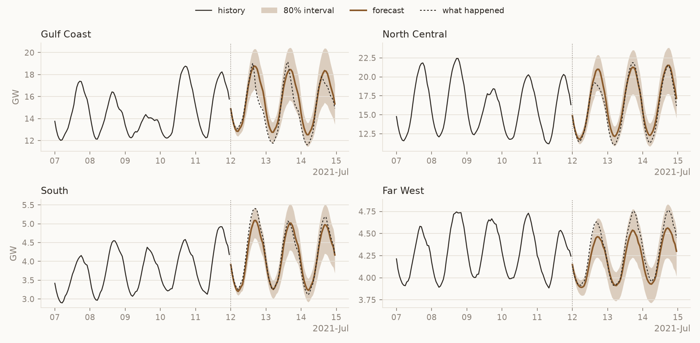
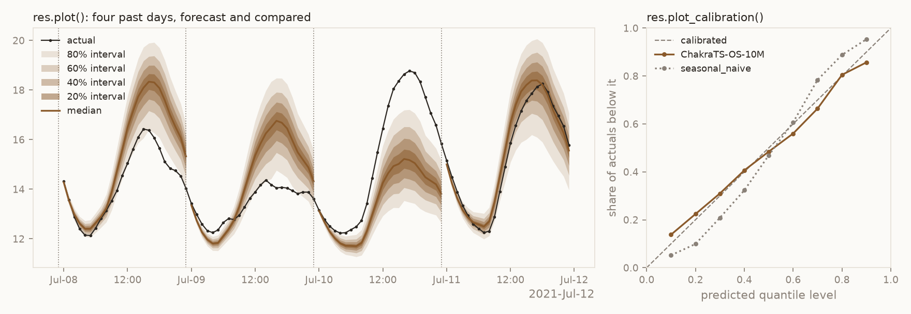
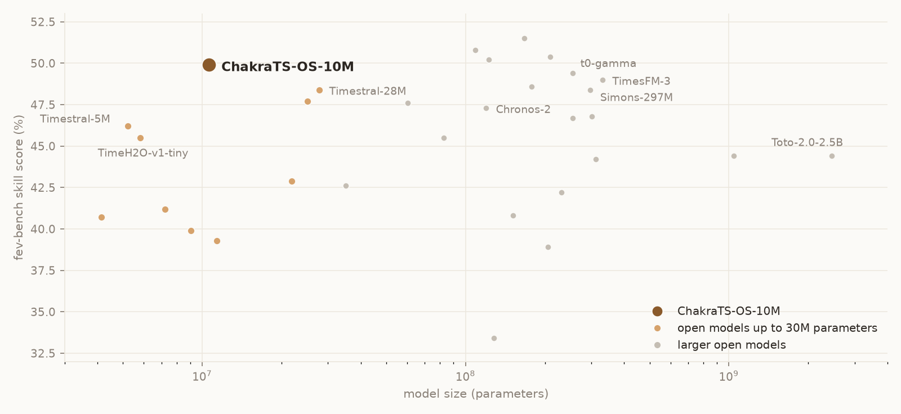

<h1 align="center">yhatmodels</h1>

<p align="center">Open foundation models from YHat Labs that run on your own computer.</p>

<p align="center">
  <a href="https://pypi.org/project/yhatmodels/"></a>
  <a href="https://pepy.tech/projects/yhatmodels"></a>
  <a href="https://pypi.org/project/yhatmodels/"></a>
  <a href="https://huggingface.co/yhatlabs/ChakraTS-OS-10M"></a>
  <a href="https://colab.research.google.com/github/yhatlabs/yhatlabs-cookbook/blob/main/getting-started/chakrats-os-10m.ipynb"></a>
</p>

<p align="center">
  <picture>
    <source media="(prefers-color-scheme: dark)" srcset="https://raw.githubusercontent.com/yhatlabs/yhatmodels/main/docs/assets/forecast_dark.png">
    
  </picture>
  <br>
  <sub>A week of hourly electricity demand on the Texas Gulf Coast, forecast from two weeks of history, with no training.
  Data: <a href="https://www.ercot.com">ERCOT</a>.</sub>
</p>

**ChakraTS-OS-10M**, our first open model, forecasts any time series from its history, with a range of likely values
around every step and no training on your data. It uses what you know about the future, reads up to 32,768 past values,
and with 10.6M parameters runs on a laptop CPU. It is the most accurate open forecasting model under 100M parameters on
fev-bench (see [Results](https://github.com/yhatlabs/yhatmodels#results)).

> Forecasting in production? Use ChakraTS, our most accurate model, through the
> [YHat Labs API](https://github.com/yhatlabs/yhatlabs-python).

## Quick start

```bash
pip install yhatmodels
```

```python
import numpy as np
from yhatmodels import ChakraTS

model = ChakraTS.from_pretrained("ChakraTS-OS-10M")
history = 10 + np.sin(np.arange(500) / 24 * 2 * np.pi)  # any series: sales, demand, sensor readings
q = model.forecast(history, h=48)                         # the next 48 steps: quantiles 0.1, 0.5 and 0.9
```

The first download asks you to accept the [model license](https://github.com/yhatlabs/yhatmodels#license) once, with a
free yhatlabs.com account. After that the model runs entirely on your computer. Or start with the
[getting-started notebook](https://colab.research.google.com/github/yhatlabs/yhatlabs-cookbook/blob/main/getting-started/chakrats-os-10m.ipynb)
in Colab.

## What you can do

### Get a range, not just a number

Ask for the intervals you need; an 80% interval should hold the actual value about 80% of the time.

```python
q = model.forecast(history, h=48, level=[80, 95])  # (48, 5): the 95% and 80% interval edges around the median
```

### Use what you know about the future

Name the columns you know ahead as `known`, with their future values in the rows after your last observation.

```python
# df: one row per hour with ds, y (solar output), sunlight and clouds;
# the last 48 rows hold tomorrow's weather forecast, with y empty
fc = model.forecast(df, h=48, known=["sunlight", "clouds"])
```

<p align="center">
  <picture>
    <source media="(prefers-color-scheme: dark)" srcset="https://raw.githubusercontent.com/yhatlabs/yhatmodels/main/docs/assets/covariates_dark.png">
    
  </picture>
  <br>
  <sub>From history alone, the model expects another sunny day; with sunlight and cloud cover it sees the cloudy one
  coming. Data: <a href="https://www.kaggle.com/datasets/samanemami/renewable-energy-and-weather-conditions">Renewable Energy and Weather Conditions</a> (CC0).</sub>
</p>

### Forecast your tables

One row per series and timestamp in; one row per future step out, with the quantiles or intervals you ask for.

```python
fc = model.forecast(df, h=7, known=["price", "promo"], level=[80, 95])
fc.head()  # unique_id, ds, q2.5, q10, median, q90, q97.5
```

<p align="center">
  <picture>
    <source media="(prefers-color-scheme: dark)" srcset="https://raw.githubusercontent.com/yhatlabs/yhatmodels/main/docs/assets/tables_dark.png">
    
  </picture>
  <br>
  <sub>Four regions of the Texas grid, forecast three days ahead in one call. Data: <a href="https://www.ercot.com">ERCOT</a>.</sub>
</p>

### Check it on your own history

`evaluate` forecasts from a few points in each series' past and scores the forecasts against what happened, next to a
seasonal baseline.

```python
res = model.evaluate(df, h=7, windows=3)
res.summary            # accuracy per model, and how much better than the baseline
res.plot()             # each forecast against what happened (pip install "yhatmodels[plot]")
res.plot_calibration() # do 10% of actual values fall below the 10% quantile, and so on?
```

<p align="center">
  <picture>
    <source media="(prefers-color-scheme: dark)" srcset="https://raw.githubusercontent.com/yhatlabs/yhatmodels/main/docs/assets/backtest_dark.png">
    
  </picture>
  <br>
  <sub>Four past days of Gulf Coast demand, each forecast from the history before it, and the calibration across all four
  regions.</sub>
</p>

### Fine-tune on your data

`tune` adapts the model to your own patterns (promotions, paydays) in seconds to minutes on a CPU, and keeps the tune only
if it beats the original on your held-out history.

```python
tuned = model.tune(df, h=7)
tuned.save("my-tuned/")
```

### From the command line

```bash
yhatmodels forecast sales.csv --h 7 --known price,promo --level 80,95 -o forecast.csv
yhatmodels evaluate sales.csv --h 7 --windows 3
```

Every option is in the [usage guide](https://github.com/yhatlabs/yhatmodels/blob/main/docs/usage.md).

## Results

[fev-bench](https://huggingface.co/spaces/autogluon/fev-leaderboard) scores forecasting models on 100 tasks; the skill
score says how much more accurate a model is than a simple seasonal forecast (higher is better).

<p align="center">
  <picture>
    <source media="(prefers-color-scheme: dark)" srcset="https://raw.githubusercontent.com/yhatlabs/yhatmodels/main/docs/assets/results_dark.png">
    
  </picture>
</p>

| Model | Parameters | All 100 tasks | 42 tasks with covariates |
|---|---|---|---|
| ci-proto | 167M | 51.5 | 53.0 |
| TimeH2O-v1 | 109M | 50.8 | 51.4 |
| Timestral-209M | 209M | 50.4 | 50.7 |
| **ChakraTS-OS-10M** | **10.6M** | **49.9** | **50.1** |
| t0-gamma | 256M | 49.4 | 49.3 |
| TimesFM-3 | 331M | 49.0 | 49.0 |
| Simons-297M | 297M | 48.4 | 47.3 |
| Chronos-2 | 119M | 47.3 | 47.0 |
| Timestral-5M | 5.2M | 46.2 | 44.5 |
| TimeH2O-v1-tiny | 5.8M | 45.5 | 41.5 |
| Toto-2.0-2.5B | 2.5B | 44.4 | 38.8 |

<sub>fev-bench skill score (%), November 2026, computed as the leaderboard does from the result files in the
[fev repository](https://github.com/autogluon/fev); sizes from the models' Hugging Face pages
([data](https://github.com/yhatlabs/yhatmodels/blob/main/docs/benchmarks.csv)). Our GIFT-Eval and TIME results, and
notebooks that reproduce all three, are in the [cookbook](https://github.com/yhatlabs/yhatlabs-cookbook/tree/main/benchmarks).</sub>

## Open model or API?

| | yhatmodels (this library) | YHat Labs API |
|---|---|---|
| Model | ChakraTS-OS-10M, open weights | ChakraTS, our most accurate model |
| Runs | on your computer | on our servers |
| For | research, evaluation, personal projects, competitions | production and commercial use |
| Start | `pip install yhatmodels` | `pip install yhatlabs`, with a key from [yhatlabs.com](https://yhatlabs.com/models/signup) |

Both use the same argument names, so code moves from one to the other with few changes.

## Models

| Model | Task | Parameters | History read | Output | License |
|---|---|---|---|---|---|
| [ChakraTS-OS-10M](https://huggingface.co/yhatlabs/ChakraTS-OS-10M) | forecasting | 10.6M | up to 32,768 steps | quantiles at any level | [non-commercial](https://yhatlabs.com/model-license) |

## License

The `yhatmodels` code is [Apache-2.0](https://github.com/yhatlabs/yhatmodels/blob/main/LICENSE). The ChakraTS-OS-10M
weights are under the [Chakra Non-Commercial Model License](https://yhatlabs.com/model-license): free for academic research,
personal use, evaluation for up to 90 days and data science competitions. For commercial use, use the
[YHat Labs API](https://github.com/yhatlabs/yhatlabs-python) or write to [licensing@yhatlabs.com](mailto:licensing@yhatlabs.com).

The first download asks you to accept the license once, with a free yhatlabs.com account:

- **On your computer:** your browser opens; sign in or create an account, accept, and the download starts.
- **Over SSH:** the terminal shows a link; open it anywhere and paste back the token it shows.
- **In CI or scripts:** set `YHAT_MODELS_TOKEN` (from [yhatlabs.com/models/license](https://yhatlabs.com/models/license)),
  or run `yhatmodels accept-license ChakraTS-OS-10M` once.

## Questions

**Does my data leave my computer?** No. The only call to YHat Labs is the license check before the first download, which
sends your token and nothing else.

**Can I use it offline?** Yes. Once downloaded, the weights stay in the Hugging Face cache and later runs need no network.

**Do I need a GPU?** No. An NVIDIA or Apple GPU helps with large batches and long histories.

**What can't it do?** It returns quantiles, not sample paths; it has no static covariates; it reads at most the last
32,768 steps; and forecasts past 768 steps continue in blocks and lose accuracy. The hosted ChakraTS adds sample paths and
static covariates.

## Citation

```bibtex
@misc{yhatlabs2026chakratsos,
  title        = {{ChakraTS-OS}: open-weight time-series forecasting models},
  author       = {{YHat Labs}},
  year         = {2026},
  howpublished = {\url{https://huggingface.co/yhatlabs/ChakraTS-OS-10M}},
  url          = {https://huggingface.co/yhatlabs/ChakraTS-OS-10M}
}
```

[yhatlabs.com](https://yhatlabs.com) · [founders@yhatlabs.com](mailto:founders@yhatlabs.com)
